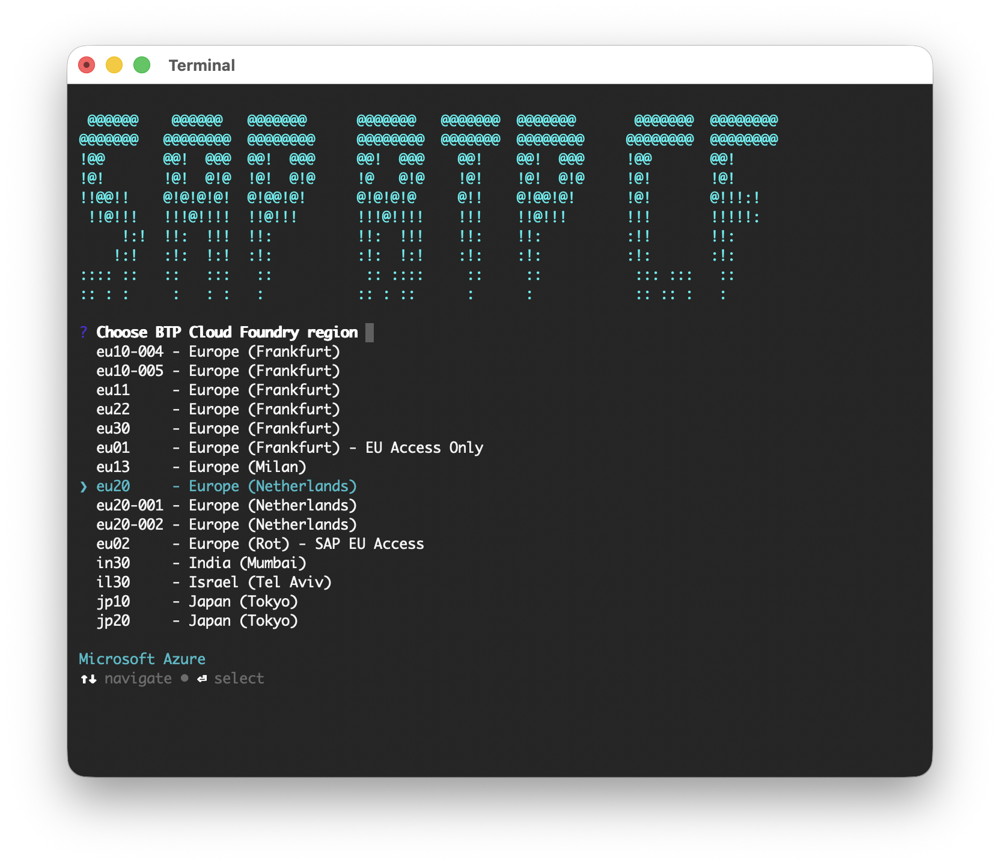

# SAP BTP Cloud Foundry Login Helper

This Node.js project makes it easier to login to the SAP BTP Cloud Foundry environment with the command line interface `cf`.
After installation you can use the shell command `btpcflogin` to get a guided login to the platform.
It runs on Linux, Windows and macOS - implemented and tested with WSL2 - Ubuntu and macOS.

## Features

- Guided, interactive login: region, credentials, org and space are all chosen from type-ahead lists
- Complete region list including extension landscapes, matching the [SAP Help documentation](https://help.sap.com/docs/btp/sap-business-technology-platform/regions-and-api-endpoints-available-for-cloud-foundry-environment)
- Credentials are read from your password manager - `pass` (Linux), `gopass` (Windows) or `KeePassXC` (macOS) -
  so passwords never end up in the shell history
- Single Sign On with a temporary passcode as login alternative
- Supports custom identity providers (IdP origin)
- Favorites: store region/org/space/login combinations and log in with a single selection (`-f`)
- macOS: optional caching of the KeePassXC database password in the Keychain
- Runs in headless environments (e.g. WSL2)



## Prerequisites

- The Cloud Foundry CLI `cf` ([install instructions](https://docs.cloudfoundry.org/cf-cli/install-go-cli.html))
- [Node.js](https://nodejs.org/en/download/package-manager/#nvm) runtime 22.12 or higher
- A [git](https://git-scm.com/book/en/v2/Getting-Started-Installing-Git) installation, if you want to run from source
- A credential manager, to use stored login credentials besides the SSO option that is provided by the Cloud Foundry CLI:

| Platform | Manager                                                                                                               |
| -------- | --------------------------------------------------------------------------------------------------------------------- |
| Linux    | `pass` - the standard linux password manager ([install and setup](https://www.passwordstore.org/))                    |
| Windows  | `gopass` - cross-platform password manager that is compatible to `pass` ([install and setup](https://www.gopass.pw/)) |
| macOS    | `KeePassXC` - cross-platform password manager, used via its bundled `keepassxc-cli` ([install and setup](https://keepassxc.org/)) |

`add-login` lists the entries of the password store: on Linux from `$PASSWORD_STORE_DIR`
(defaults to `~/.password-store`), on Windows from `%LOCALAPPDATA%\gopass\stores\root` and
on macOS from the configured KeePassXC database.

## Installation

Install as shell command from npm:

`npm i -g btpcflogin`

Run from source:

1. Clone git repo and cd into cloned repo
2. `npm i`
3. `npm run local`

Install as shell command from source:

1. Clone git repo and cd into cloned repo
2. `npm i`
3. `npx tsc`
4. `npm i -g`

Run the unit tests:

`npm test`

## Available Commands

- `login` (default)  
  Starts complete Login to Cloud Foundry. As this is the default command it can be omitted and is triggered by executing `btpcflogin`.

  Options:

  - `-s, --store-favorite`  
    Stores the cf target after successful login in the config store

  - `-f, --use-favorite`  
    Use stored favorite to login even faster

- `add-login`  
  Interactively adds a new `pass`/`gopass`/KeePassXC login to the config store

- `rm-login`  
  Interactively removes a `pass`/`gopass`/KeePassXC login from the config store

- `sort-logins`  
  Allows reordering of the stored `pass`/`gopass`/KeePassXC logins in the config store

- `t` (target)  
  Interactive setting of new target (org and space), by using the current API region and logon token. (see `cf t`)

- `sort-favs`  
  Allows reordering of the stored favorites in the config store

- `rename-fav`  
  Rename a stored favorite in the config store

- `rm-fav`  
  Remove single cf target favorite from the config store

### Example calls

```sh
# Login
btpcflogin

# Login and store the chosen org, space, api region and pass login into favorite
btpcflogin -s

# Login using a stored favorite
btpcflogin -f

# choose target
btpcflogin t

# Add new 'pass' login
btpcflogin add-login
```

## Credential format

It is assumed that the login data is stored in the following format in a pass file:

``` pass
<password of SAP S-user>
username: <e-mail of SAP S-user>
origin: <origin or custom IdP>
```

**Hint**: The origin is only required if the credentials are from a custom identity provider.

The username and origin lines must start with the prefixes `username: ` and `origin: `.

### Credential format for KeePassXC (macOS)

On macOS the login data is read from a regular KeePassXC entry:

- **Username**: e-mail of SAP S-user
- **Password**: password of SAP S-user
- Additional attribute `origin` (optional): origin key of a custom IdP

The path to the KeePassXC database (`*.kdbx`) is requested once and stored in the config store.
It can be overridden with the environment variable `BTPCFLOGIN_KDBX`.

If `keepassxc-cli` is not on the PATH, `btpcflogin` automatically detects the executable that is
bundled with the KeePassXC app (in `/Applications` or `~/Applications`) and remembers it in the config store
after a confirmation. A custom location can be entered as well.

After the first successful unlock you are asked once whether the database password should be
remembered in the macOS Keychain. If stored, subsequent runs unlock the database automatically
(when the database password changes, you are prompted again and the Keychain entry is updated).
Remove the stored password anytime with `security delete-generic-password -s btpcflogin`.
The yes/no choice is remembered as `keePassXcKeychain` in the config store - remove the property
to be asked again.

## Config store

All settings of `btpcflogin` (logins, favorites, KeePassXC paths) are kept in a
[configstore](https://github.com/sindresorhus/configstore) file at
`~/.config/configstore/btpcflogin.json` (respects `$XDG_CONFIG_HOME`).
